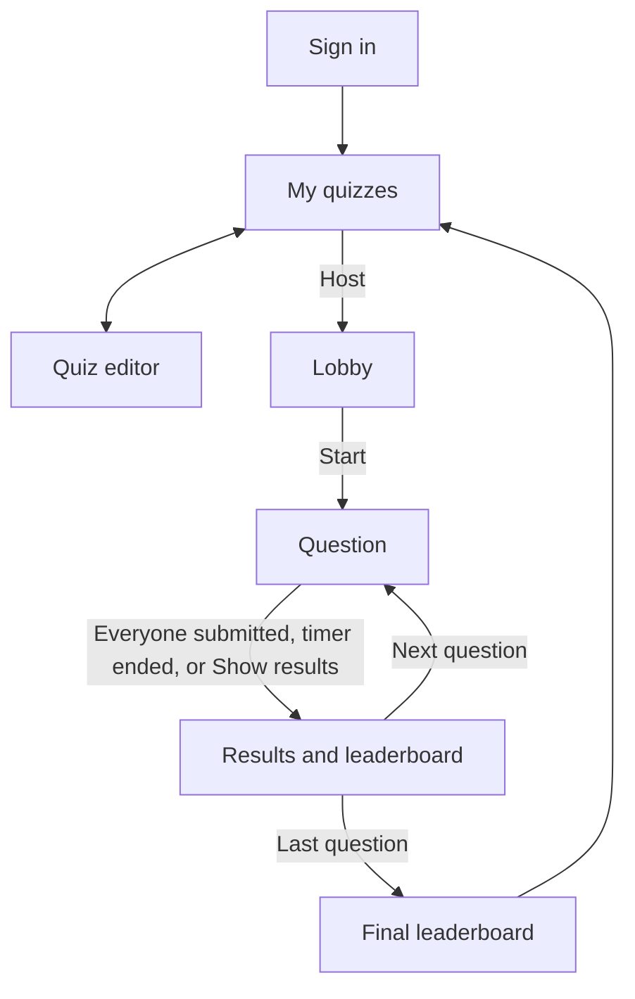
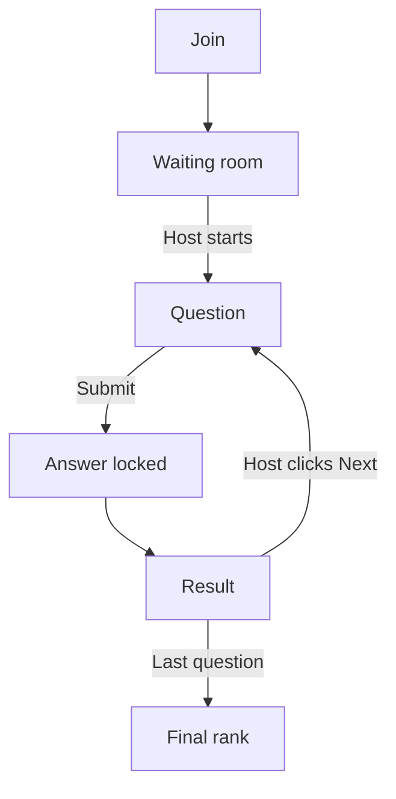

# Quiz App Wireframe

Structure only. Dashed boxes are regions, solid boxes are things you click or type into, and the names, codes and questions are examples. Colours and fonts come later in Look & Feel.

[How screens connect](#flow) [Sign in](#t-signin) [My quizzes](#t-quizzes) [Quiz editor](#t-editor) [Answer areas](#t-answers) [Lobby](#p-lobby) [Question](#p-question) [Results](#p-results) [Final](#p-final) [Student join](#s-join) [Student question](#s-question) [Student states](#s-other)

## How screens connect

Teacher and projector



Student



## Teacher screens (your own laptop)

### Sign in

Teacher · public link, first page

Header

ExitCode

Sign-in card

Continue with Google

or

Email

Password

Sign inCreate account with email

After email sign-up: "Check your inbox to confirm your email." Sign-in is blocked until it is confirmed.

Message area (only shown after a failed sign-in)

"This email isn't on the approved teacher list."

Students never see this screen. They go straight to the Join screen.

### My quizzes

Teacher · home after sign-in

Top bar

ExitCodeteacher@email.comSign out

Toolbar

\+ New quizImport quiz file

Quiz list (only this teacher's quizzes)

**Python basics: loops**\
10 questions · edited today HostEditDuplicateExportDelete

**HTML tags quick check**\
6 questions · edited last week HostEditDuplicateExportDelete

Delete asks "Delete this quiz? This can't be undone." with Cancel and Delete buttons right there in the row, not in a pop-up.

Empty state (when there are no quizzes yet)

No quizzes yet. Click "+ New quiz" or import a quiz file.

### Quiz editor

Teacher · opens from New quiz or Edit

Top bar

← My quizzesQuiz title SavedHost this quiz

Question list (drag to reorder)

⋮⋮1. What does this print? Multiple choice⧉ ✕

⋮⋮2. Which are valid names? Multi answer⧉ ✕

⋮⋮3. Order the lines Order lines⧉ ✕

\+ Add question

⧉ duplicates the question, ✕ deletes it. The selected question (bold) is the one open on the right.

Question form

Question type

Question text, for example: "What does this code print?"

Optional code block (one per question)

Language: PythonRemove code block

```
for i in range(3):
    print(i * 2)
```

The editor shows the code with syntax highlighting as you type. Languages: Python, JavaScript, HTML, CSS, Plain text.

Answer area (changes with the question type, see next section)

Answer options go here

Timing

( )Wait for everyone(•)Timed

30seconds (5 to 300)10203060120

The seconds box and quick-pick buttons only show when Timed is selected. Speed bonus applies to timed questions only.

Explanation (optional, shown on the results screen)

"range(3) gives 0, 1, 2, so i * 2 gives 0, 2, 4."

### Editor answer areas, one per question type

Teacher · replaces the "Answer area" box above

Multiple choice, one answer

(•)

Option A textText

✕

( )

Option B textText

✕

( )

CodePython

```
len(items)
```

✕

\+ Add option

The filled dot marks the correct answer. Each option is either Text or a Code block with its own language.

Multiple choice, several answers

\[x\]Option A text✕

\[ \]Option B text✕

\[x\]Option C text✕

\+ Add option

Same option rows as above, with tick boxes for every correct option. Each option can also be Text or Code.

True / False

(•)True

( )False

The two options are fixed. Pick which one is correct.

Short text answer

Accepted answer: len✕

Accepted answer: len()✕

\+ Add accepted answer

\[ \]Case-sensitive

Marking ignores capital letters and extra spaces unless Case-sensitive is ticked.

Fill in the blank (code)

Language: Python

```
for i in {{1}}(3):
    {{2}}(i)
```

Word bank

range ✕print ✕len ✕+ Add word

Correct word for each blank

Blank 1range

Blank 2print

Type {{1}}, {{2}} and so on in the snippet to mark the blanks. Students pick a word from the bank for each blank.

Order the lines

Language: Python

⋮⋮def greet(name):✕

⋮⋮ return "Hi " + name✕

⋮⋮print(greet("Sam"))✕

\+ Add line

Lines are listed in the correct order. Students see them shuffled.

## Classroom screen (projector, your laptop connected to it)

### Lobby

Projector · after clicking Host

Join instructions

Go to **\[site address\]** and enter this code

K7M2QX

Quiz: Python basics: loops · 10 questions

Players joined (5)

SamLinhMinhMaiJake

Names appear as students join. Joining is closed once the game starts.

Start gameCancel gameStart is disabled until at least one player has joined.

### Question

Projector · shown while students answer

Top strip

Question 3 of 10Multiple choiceTimer 0:24only on timed questions4 of 5 submitted

Question

What does this code print?

```
for i in range(3):
    print(i * 2)
```

Answer options (lettered, same order as on student screens)

A0 2 4

B2 4 6

C0 1 2

D0 2 4 6

Other types show their content here instead: True/False shows the two options, Short text shows "Type your answer", Fill in the blank shows the snippet with empty blanks and the word bank, Order the lines shows the shuffled lines. Correct answers are never shown on this screen.

Who has answered

Sam✓ submittedLinh✓ submittedMinhwaiting…Mai✓ submittedJake✓ submitted

Show results nowTeacher control. Moves on straight away even if some students haven't answered.

### Results and leaderboard

Projector · after every question

Question 3 of 10 · ResultsMultiple choice

Correct answer

A0 2 4

Explanation (only if the teacher wrote one)

range(3) gives 0, 1, 2, so i * 2 gives 0, 2, 4.

For multi-answer, fill-in-the-blank and order questions, this box shows the full correct set, snippet or line order.

Leaderboard (ranked by total score)

1Linh✓ +14804120

2Sam✓ +13503970

3Mai½ +5003200

4Jake✗ +02800

5Minh– no answer2100

Columns: rank, name, result for this question and points earned, total score. ½ means partial credit.

Next questionOn the last question this button says "Finish game".

### Final leaderboard

Projector · after the last question

Top three

2Sam · 8970

1Linh · 9420

3Mai · 8100

Everyone else

4Jake7600

5Minh6400

Back to my quizzesResults are not saved. Hosting the quiz again creates a new game with a new code.

## Student screens (their own laptops)

### Join and waiting room

Student · opens from the public link

Join

ExitCode

Game code

Your name

Join game

Error messages (one at a time, under the button)

- "We can't find a game with that code."
- "That name is taken. Pick another."
- "This game has already started."

Waiting room

You're in, Sam

Waiting for the teacher to start…

SamLinhMinh

The list of joined players is shown so students can see they are in the right game.

### Question and answer locked

Student · while answering

Question screen

SamQuestion 3 of 100:24

What does this code print?

```
for i in range(3):
    print(i * 2)
```

( ) A0 2 4

( ) B2 4 6

( ) C0 1 2

( ) D0 2 4 6

Submit answer

The timer is only shown on timed questions. Submit stays disabled until something is chosen.

After submitting

SamQuestion 3 of 10

Answer submitted

Waiting for the others… (4 of 5)

The answer can't be changed. The screen moves to the result when everyone has submitted, the timer ends, or the teacher clicks Show results now.

Answer area by question type (replaces the A to D options above)

Multiple choice, one answerRadio buttons, as shown above. Options can be text or code blocks.

Multiple choice, several answers

\[ \] AOption text

\[ \] BOption text

Tick boxes. Tick all that apply.

True / False

TrueFalse

Short text answer

Type your answer

Fill in the blank

```
for i in [ range ▾ ](3):
    [ choose ▾ ](i)
```

Each blank is a dropdown listing the word bank.

Order the lines

⋮⋮print(greet("Sam"))

⋮⋮def greet(name):

⋮⋮ return "Hi " + name

Drag lines into the right order.

### Result, final rank and error states

Student · after each question and at the end

Result after a question

Correct!

+1000 points · +350 speed bonus

A0 2 4 correct answer

Explanation (if provided)

range(3) gives 0, 1, 2, so i * 2 gives 0, 2, 4.

Your rank: 2ndTotal: 3970

Waiting for the teacher to continue…

The heading changes to "Partly correct", "Not quite" or "No answer" as needed.

Final screen

Game over

You finished 2nd with 8970 points

Join another game

Disconnected (after a refresh or lost connection mid-game)

You've left this game

You can't rejoin a game that has started.

Back to join screen

Teacher left

The game has ended

The teacher closed the game.

Back to join screen